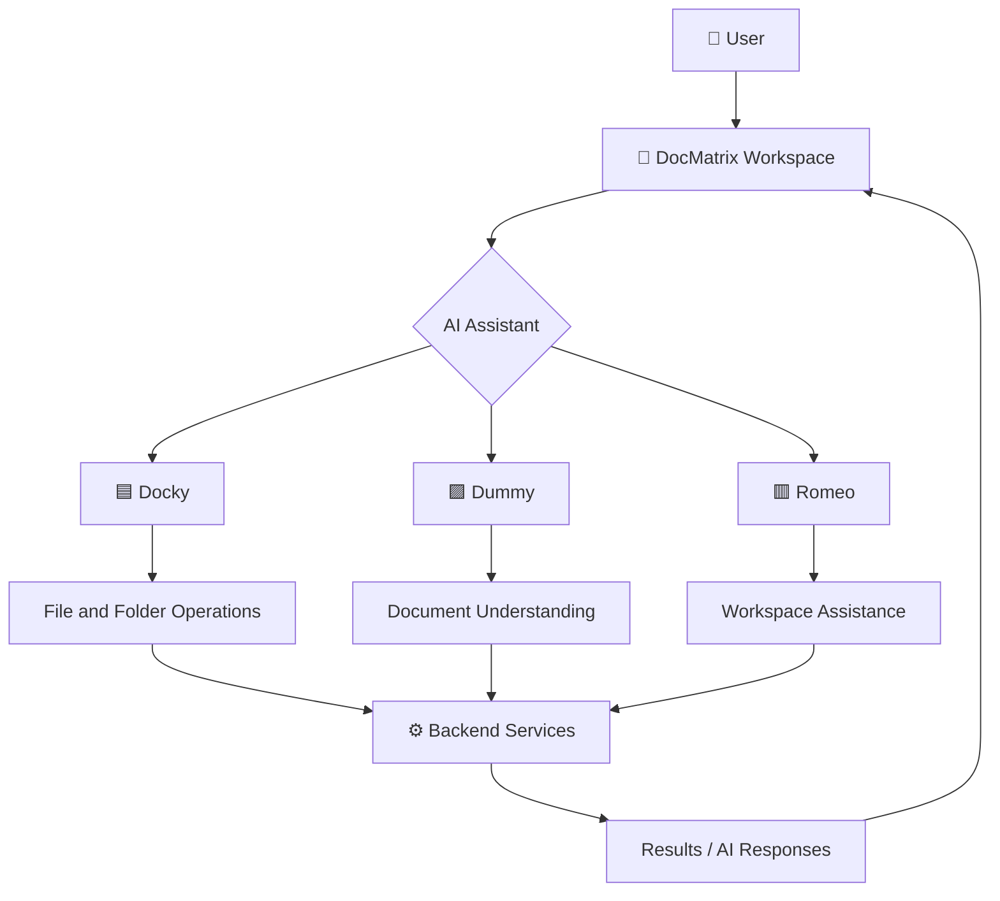
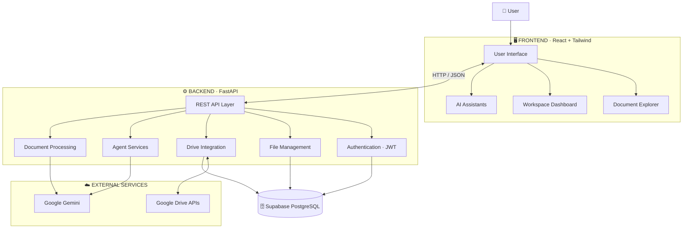

<div align="center">

<h1><b>📂 DOCMATRIX</b></h1>

<h3>Intelligent Document Management &amp; Agentic Workspace</h3>

<p><b>Multiple Google Drives · One Workspace · Three AI Agents</b></p>

<p>


</p>

<p><a href="https://docmatrixsdms.vercel.app"><b>🌐 docmatrixsdms.vercel.app</b></a></p>

<p>
<a href="#-about">About</a> •
<a href="#-why-docmatrix">Why</a> •
<a href="#-features">Features</a> •
<a href="#-ai-agent-fleet">Agents</a> •
<a href="#-system-architecture">Architecture</a> •
<a href="#-tech-stack">Tech Stack</a> •
<a href="#-security">Security</a> •
<a href="#-deployment">Deployment</a> •
<a href="#-local-setup">Setup</a>
</p>

</div>

---

## 📖 About

**DocMatrix** is an AI-powered document management workspace that brings multiple Google Drive accounts together into one organized interface. Instead of switching between accounts to find, move or manage files, users get a single explorer, a shared folder structure and a live view of their storage.

On top of this unified workspace sit three AI agents. Users can manage files by simply describing what they want, ask questions about any document, and work hands-free through voice commands. The result is a workspace where documents are not just stored, but understood and controlled through conversation.

---

## 🎯 Why DocMatrix

Managing documents across several Drive accounts is slow, repetitive and easy to get wrong. DocMatrix removes that friction by combining storage management, document processing and agentic AI in one place.

| ❌ The Problem | ✅ The DocMatrix Answer |
| :--- | :--- |
| Files scattered across multiple Drive accounts | One unified explorer for every connected Drive |
| Constant account switching to find a file | A single browse and search experience |
| Manual clicking to rename, move or compress | Natural-language commands through an AI agent |
| Reading long documents to find one detail | Summaries, Q&A and entity extraction with Gemini |
| Separate tools for PDF merge, compress and convert | Built-in document and PDF utilities |
| No clear view of storage across accounts | A storage dashboard across all connected Drives |

---

## ✨ Features

DocMatrix covers the full document lifecycle: connecting storage, exploring files, understanding content, automating operations and monitoring the workspace.

### ☁️ Unified Google Drive Workspace

Each Google Drive account is connected independently through Google OAuth and appears inside the same interface. Files from every account can be browsed, organized and monitored without logging in and out.

- **Multi-account connect:** link any number of Google Drive accounts
- **Single interface:** browse all accounts without switching logins
- **Virtual folders:** organize files from different Drives in one structure
- **Storage monitoring:** see drive details and available space per account

### 📁 Intelligent Document Explorer

The explorer works like a desktop file manager, with several ways to view, filter and inspect documents.

- **Views:** Grid, List and Details
- **Sections:** All Files, Recent, Favorites and Shared
- **Inspection:** property panel with file metadata
- **File operations:** create, rename, move, copy, upload and download
- **Organization:** tags, favorites and shareable links
- **Processing:** compress, merge and convert supported documents

### 🧠 AI Document Intelligence

Select a document and the assistant Dummy reads it for you. Answers come from the document itself, and follow-up questions stay in the same context.

- **Summarize:** get a structured summary of the selected document
- **Ask questions:** receive answers based on the document content
- **Extract entities:** pull out names, dates, locations and key information
- **Follow-up chat:** continue the conversation with the same document context

### ⚡ Agentic Automation

With Docky, routine file work becomes a sentence. The agent identifies the intent, picks the right backend operation and executes it, with support for multi-step requests and voice.

| You Say | DocMatrix Does |
| :--- | :--- |
| "Rename this file to Report 2026" | Renames the document |
| "Create a folder named Projects" | Creates the folder |
| "Move these files to Projects" | Moves the selected files |
| "Compress these documents" | Compresses the documents |
| "Find my recent PDF files" | Searches and lists matching files |
| "Generate a sharing link" | Creates a shareable link |

Also included: multi-action execution, voice input and output, interactive voice conversations, Performance Mode and Safe Mode.

### 🛠️ Document Productivity Tools

Common document tasks are built into the workspace, so users do not need to jump to separate utilities.

- **PDF viewer:** view and process PDF documents
- **Merge and compress:** combine files and reduce their size
- **Format conversion:** convert supported document formats
- **Signature tools:** digital signature-related functionality
- **Analysis and extraction:** analyze documents and pull out information
- **Backup utilities:** keep copies of important documents

### 📊 Workspace and Administration

A central dashboard keeps users informed about what is connected, how much space is used and what has happened recently.

- **Dashboard:** workspace overview in one place
- **Storage:** utilization indicators and connected-drive monitoring
- **Activity:** activity tracking and operation feedback
- **Administration:** workspace settings and admin analytics
- **Notifications:** alerts for operations and workspace events

---

## 🤖 AI Agent Fleet

DocMatrix does not rely on a single assistant. Three agents share the workspace, each with a focused job, and all of them run through the same backend services.

### 🟦 Docky: Document Management Agent

Handles every file operation that can be described in plain language, from renaming to compressing.

- Natural-language file and folder control
- Multi-file and multi-action execution
- Search, move, copy, merge and convert
- Voice input and output with Performance and Safe modes

```text
Instruction → Intent → Action → Backend Tool → Result
```

### 🟪 Dummy: Document Intelligence Assistant

Reads the selected document and answers from its content, so nobody has to scan pages manually.

- Structured document summaries
- Contextual question answering
- Extraction of names, dates and locations
- Follow-up chat inside the document context

```text
Select Document → Process Content → Gemini → Contextual Answer
```

### 🟥 Romeo: AI Workspace Assistant

Provides workspace-level assistance as part of the integrated agent ecosystem alongside Docky and Dummy.

- Specialized assistant within the platform
- Works alongside Docky and Dummy
- Runs through the same backend services
- Extends the AI-assisted workspace experience

```text
Request → Workspace Context → Response
```

### Agent Interaction Model

Every request enters through the workspace, is routed to the right agent, executed by the backend and returned as a result or response.

<div align="center">



</div>

---

## 🏛️ System Architecture

DocMatrix follows a clean three-tier design. A React frontend talks to a FastAPI backend over REST, and the backend connects to Supabase PostgreSQL, Google Drive and Gemini.

<div align="center">



</div>

Each layer has a single responsibility, which keeps the system easy to extend.

| Layer | Responsibility |
| :--- | :--- |
| **React Frontend** | Renders the workspace, explorer and AI interfaces |
| **REST API Layer** | Handles requests, routing and validation |
| **Authentication** | Verifies users and protects resources |
| **Drive Integration** | Connects and manages authorized Google Drives |
| **Agent Services** | Interprets instructions and invokes backend tools |
| **Document Processing** | Extracts and prepares document content |
| **Gemini Integration** | Powers document understanding and question answering |
| **PostgreSQL on Supabase** | Stores persistent application data and metadata |

> 💡 **Design note:** documents stay in their original Google Drive accounts. The database holds application records and metadata, so files are never duplicated just to be managed.

---

## ⚙️ Tech Stack

Each technology was chosen for a specific responsibility, from interactive UI rendering to asynchronous API handling and managed data storage.

| Layer | Technologies | Why It Fits |
| :--- | :--- | :--- |
| **Frontend** |    | Component-based UI, dynamic rendering, consistent styling |
| **Backend** |   | Async APIs, request validation, rich AI ecosystem |
| **Database** |   | Relational storage on managed infrastructure |
| **AI** |  | Contextual document analysis and Q&A |
| **Integrations** |   | Authorized access to connected Drive accounts |
| **Authentication** |   | Token-based protection for APIs |
| **Hosting** |   | Separate frontend and backend deployment |

---

## 🔐 Security

Application login and Drive access are handled separately. DocMatrix authenticates its own users, while Google OAuth controls what each connected Drive account allows.

- **JWT authentication:** protects application API endpoints
- **Google OAuth 2.0:** user-approved access to each Drive account
- **Backend validation:** every file operation is validated before execution
- **Environment variables:** API keys and secrets stay out of source code
- **User access controls:** resources stay scoped to each user
- **Safe Mode:** restricted agent execution for safer actions

> 🔒 **Principle:** Google governs Drive permissions, and DocMatrix governs application-level authentication and operation validation.

---

## 🚀 Deployment

DocMatrix runs as three independently hosted services. Splitting them lets each part scale and update on its own.

- **Frontend:** React application served from Vercel
- **Backend:** FastAPI services and AI agents hosted on Render
- **Database:** managed PostgreSQL on Supabase

---

## 💻 Local Setup

Follow these steps to run DocMatrix on your own machine.

**Prerequisites**

- Python 3.11+
- Node.js and npm
- Git
- Supabase account
- Google Cloud project with the Drive API enabled
- Google OAuth credentials
- Gemini API key

### 1️⃣ Clone the Repository

```bash
git clone https://github.com/premnarayn13/DocMatrix.git
cd DocMatrix
```

### 2️⃣ Set Up the Backend

```bash
python -m venv venv

# Windows
venv\Scripts\activate

# Linux / macOS
source venv/bin/activate

pip install -r requirements.txt
```

### 3️⃣ Configure Environment Variables

Create a `.env` file in the backend folder:

```env
GEMINI_API_KEY=your_gemini_api_key

SUPABASE_URL=your_supabase_url
SUPABASE_KEY=your_supabase_key

GOOGLE_CLIENT_ID=your_google_client_id
GOOGLE_CLIENT_SECRET=your_google_client_secret
```

### 4️⃣ Run the Backend

```bash
python run.py
```

Or start FastAPI directly:

```bash
uvicorn app.main_new:app --reload --port 8000
```

### 5️⃣ Run the Frontend

In a new terminal:

```bash
npm install
npm run dev
```

Open the local URL shown by Vite.

---


## 👨‍💻 Author

**Prem Narayn N L**
B.Tech in Artificial Intelligence and Data Science

---

<div align="center">

<h2><b>DOCMATRIX</b></h2>

<h3>Every Drive. Every Document. One Command.</h3>

<p><i>Stop searching through accounts. Start commanding your documents.</i></p>

<p><a href="https://docmatrixsdms.vercel.app"><b>🌐 Try DocMatrix Live</b></a></p>

</div>
