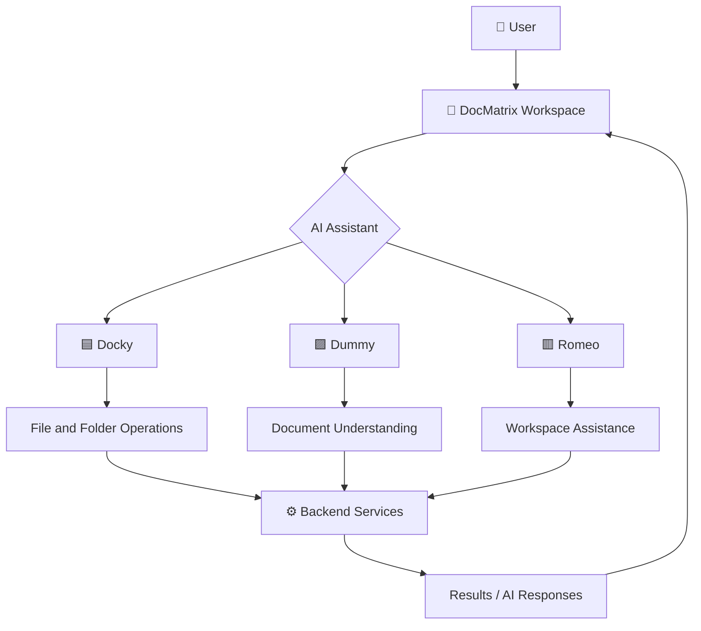
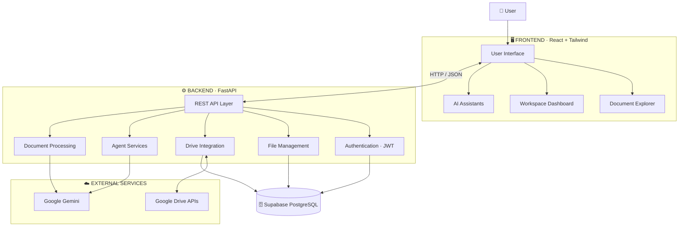

<div align="center">

<h1><b>📂 DOCMATRIX</b></h1>

<h3>Intelligent Document Management &amp; Agentic Workspace</h3>

<p><b>Multiple Google Drives · One Workspace · Three AI Agents</b></p>

<p>


</p>

<p><a href="https://docmatrixsdms.vercel.app"><b>🌐 docmatrixsdms.vercel.app</b></a></p>

<p>
<a href="#-about">About</a> •
<a href="#-why-docmatrix">Why</a> •
<a href="#-features">Features</a> •
<a href="#-ai-agent-fleet">Agents</a> •
<a href="#-system-architecture">Architecture</a> •
<a href="#-tech-stack">Tech Stack</a> •
<a href="#-security">Security</a> •
<a href="#-deployment">Deployment</a> •
<a href="#-local-setup">Setup</a>
</p>

</div>

---

## 📖 About

**DocMatrix** is an AI-powered document management workspace that brings multiple Google Drive accounts together into one organized interface. Instead of switching between accounts to find, move or manage files, users get a single explorer, a shared folder structure and a live view of their storage.

On top of this unified workspace sit three AI agents. Users can manage files by simply describing what they want, ask questions about any document, and even work hands-free through voice commands. The result is a workspace where documents are not just stored, but understood and controlled through conversation.

---

## 🎯 Why DocMatrix

Managing documents across several Drive accounts is slow, repetitive and easy to get wrong. DocMatrix removes that friction by combining storage management, document processing and agentic AI in a single place.

<div align="center">

| Without DocMatrix | With DocMatrix |
| :---: | :---: |
| Files scattered across multiple Drive accounts | One unified explorer for every connected Drive |
| Constant account switching to find a file | Single browse and search experience |
| Manual clicking to rename, move or compress | Natural-language commands through an AI agent |
| Reading long documents to find one detail | Summaries, Q&A and entity extraction with Gemini |
| Separate tools for PDF merge, compress and convert | Built-in document and PDF utilities |
| No clear view of storage across accounts | Storage dashboard across all connected Drives |

</div>

---

## ⚡ At a Glance

<div align="center">

| 🔗 Multi-Drive | 🤖 AI Agents | 🎙️ Voice | 🧠 Gemini | 🛠️ PDF Tools |
| :---: | :---: | :---: | :---: | :---: |
| Many Google accounts through OAuth | Docky, Dummy and Romeo | Voice input and output | Document understanding | Merge, compress, convert |

</div>

---

## ✨ Features

DocMatrix covers the full document lifecycle: connecting storage, exploring files, understanding content, automating operations and monitoring the workspace.

### ☁️ Unified Google Drive Workspace

Each Google Drive account is connected independently through Google OAuth and appears inside the same interface. Files from every account can be browsed, organized and monitored without logging in and out.

<div align="center">

| Capability | What It Does |
| :---: | :---: |
| <b>Multi-Account Connect</b> | Links any number of Google Drive accounts |
| <b>Single Interface</b> | Browses all accounts without switching logins |
| <b>Virtual Folders</b> | Organizes files from different Drives in one structure |
| <b>Storage Monitoring</b> | Shows drive details and available space per account |

</div>

### 📁 Intelligent Document Explorer

The explorer is designed to feel like a desktop file manager, with multiple ways to view, filter and inspect documents.

<div align="center">

| Category | Includes |
| :---: | :---: |
| <b>Views</b> | Grid, List and Details views |
| <b>Sections</b> | All Files, Recent, Favorites and Shared |
| <b>Inspection</b> | Property panel with file metadata |
| <b>File Operations</b> | Create, rename, move, copy, upload and download |
| <b>Organization</b> | Tags, favorites and shareable links |
| <b>Processing</b> | Compress, merge and convert supported documents |

</div>

### 🧠 AI Document Intelligence

Select a document and the assistant Dummy reads it for you. Answers come from the document itself, and follow-up questions stay in the same context.

<div align="center">

| Action | Result |
| :---: | :---: |
| <b>Summarize</b> | Structured summary of the selected document |
| <b>Ask Questions</b> | Answers based on the document content |
| <b>Extract Entities</b> | Names, dates, locations and key information |
| <b>Follow-Up Chat</b> | Conversation continues with the same document context |

</div>

### ⚡ Agentic Automation

With Docky, routine file work becomes a sentence. The agent identifies the intent, picks the right backend operation and executes it, with support for multi-step requests and voice.

<div align="center">

| You Say | DocMatrix Does |
| :---: | :---: |
| "Rename this file to Report 2026" | Renames the document |
| "Create a folder named Projects" | Creates the folder |
| "Move these files to Projects" | Moves the selected files |
| "Compress these documents" | Compresses the documents |
| "Find my recent PDF files" | Searches and lists matching files |
| "Generate a sharing link" | Creates a shareable link |

</div>

<div align="center">

<p>Also included: <b>multi-action execution</b> · <b>voice input and output</b> · <b>interactive voice conversations</b> · <b>Performance Mode</b> · <b>Safe Mode</b></p>

</div>

### 🛠️ Document Productivity Tools

Common document tasks are built into the workspace, so users do not need to jump to separate utilities.

<div align="center">

| Tool | Purpose |
| :---: | :---: |
| <b>PDF Viewer</b> | View and process PDF documents |
| <b>Merge and Compress</b> | Combine files and reduce their size |
| <b>Format Conversion</b> | Convert supported document formats |
| <b>Signature Tools</b> | Digital signature-related functionality |
| <b>Analysis and Extraction</b> | Analyze documents and pull out information |
| <b>Backup Utilities</b> | Keep copies of important documents |

</div>

### 📊 Workspace and Administration

A central dashboard keeps users informed about what is connected, how much space is used and what has happened recently.

<div align="center">

| Area | Coverage |
| :---: | :---: |
| <b>Dashboard</b> | Workspace overview in one place |
| <b>Storage</b> | Utilization indicators and connected-drive monitoring |
| <b>Activity</b> | Activity tracking and operation feedback |
| <b>Administration</b> | Workspace settings and admin analytics |
| <b>Notifications</b> | Alerts for operations and workspace events |

</div>

---

## 🤖 AI Agent Fleet

DocMatrix does not rely on a single assistant. Three agents share the workspace, each with a focused job, and all of them run through the same backend services.

<div align="center">

<table align="center">
<tr>
<td width="33%" valign="top" align="left">

<h3 align="center">🟦 DOCKY</h3>
<p align="center"><b>Document Management Agent</b></p>
<p>Handles every file operation that can be described in plain language, from renaming to compressing.</p>
<ul>
<li>Natural-language file and folder control</li>
<li>Multi-file and multi-action execution</li>
<li>Search, move, copy, merge and convert</li>
<li>Voice input and output with Performance and Safe modes</li>
</ul>
<p align="center"><code>Instruction → Intent → Action → Result</code></p>

</td>
<td width="33%" valign="top" align="left">

<h3 align="center">🟪 DUMMY</h3>
<p align="center"><b>Document Intelligence Assistant</b></p>
<p>Reads the selected document and answers from its content, so nobody has to scan pages manually.</p>
<ul>
<li>Structured document summaries</li>
<li>Contextual question answering</li>
<li>Extraction of names, dates and locations</li>
<li>Follow-up chat inside the document context</li>
</ul>
<p align="center"><code>Select → Process → Gemini → Answer</code></p>

</td>
<td width="33%" valign="top" align="left">

<h3 align="center">🟥 ROMEO</h3>
<p align="center"><b>AI Workspace Assistant</b></p>
<p>Provides workspace-level assistance as part of the integrated agent ecosystem alongside Docky and Dummy.</p>
<ul>
<li>Specialized assistant within the platform</li>
<li>Works alongside Docky and Dummy</li>
<li>Runs through the same backend services</li>
<li>Extends the AI-assisted workspace experience</li>
</ul>
<p align="center"><code>Request → Context → Response</code></p>

</td>
</tr>
</table>

</div>

### Agent Interaction Model

Every request enters through the workspace, is routed to the right agent, executed by the backend and returned as a result or response.

<div align="center">



</div>

---

## 🏛️ System Architecture

DocMatrix follows a clean three-tier design. A React frontend talks to a FastAPI backend over REST, and the backend connects to Supabase PostgreSQL, Google Drive and Gemini.

<div align="center">



</div>

Each layer has a single responsibility, which keeps the system easy to extend.

<div align="center">

| Layer | Responsibility |
| :---: | :---: |
| <b>React Frontend</b> | Workspace, explorer and AI interfaces |
| <b>REST API Layer</b> | Request handling, routing and validation |
| <b>Authentication</b> | Verifies users and protects resources |
| <b>Drive Integration</b> | Connects and manages authorized Google Drives |
| <b>Agent Services</b> | Interprets instructions and invokes backend tools |
| <b>Document Processing</b> | Content extraction and preparation |
| <b>Gemini Integration</b> | Document understanding and question answering |
| <b>PostgreSQL on Supabase</b> | Persistent application data and metadata |

</div>

> 💡 **Design note:** documents stay in their original Google Drive accounts. The database holds application records and metadata, so files are never duplicated just to be managed.

---

## ⚙️ Tech Stack

Each technology was chosen for a specific responsibility, from interactive UI rendering to asynchronous API handling and managed data storage.

<div align="center">

| Layer | Technologies | Why It Fits |
| :---: | :---: | :---: |
| <b>Frontend</b> |    | Component-based UI, dynamic rendering, consistent styling |
| <b>Backend</b> |   | Async APIs, request validation, rich AI ecosystem |
| <b>Database</b> |   | Relational storage on managed infrastructure |
| <b>AI</b> |  | Contextual document analysis and Q&A |
| <b>Integrations</b> |   | Authorized access to connected Drive accounts |
| <b>Authentication</b> |   | Token-based protection for APIs |
| <b>Hosting</b> |   | Separate frontend and backend deployment |

</div>

---

## 🔐 Security

Application login and Drive access are handled separately. DocMatrix authenticates its own users, while Google OAuth controls what each connected Drive account allows.

<div align="center">

| Mechanism | Purpose |
| :---: | :---: |
| <b>JWT Authentication</b> | Protects application API endpoints |
| <b>Google OAuth 2.0</b> | User-approved access to each Drive account |
| <b>Backend Validation</b> | Validates every file operation before execution |
| <b>Environment Variables</b> | Keeps API keys and secrets out of source code |
| <b>User Access Controls</b> | Keeps resources scoped to each user |
| <b>Safe Mode</b> | Restricted agent execution for safer actions |

</div>

> 🔒 **Principle:** Google governs Drive permissions, and DocMatrix governs application-level authentication and operation validation.

---

## 🚀 Deployment

DocMatrix runs as three independently hosted services: the React frontend on Vercel, the FastAPI backend on Render and the PostgreSQL database on Supabase. Splitting them lets each part scale and update on its own.

<div align="center">

| Service | Platform | Role |
| :---: | :---: | :---: |
| <b>Frontend</b> | Vercel | Serves the React application |
| <b>Backend</b> | Render | Hosts the FastAPI services and agents |
| <b>Database</b> | Supabase | Managed PostgreSQL |

</div>

---

## 💻 Local Setup

Follow these steps to run DocMatrix on your own machine.

**Prerequisites**

- Python 3.11+
- Node.js and npm
- Git
- Supabase account
- Google Cloud project with the Drive API enabled
- Google OAuth credentials
- Gemini API key

### 1️⃣ Clone the Repository

```bash
git clone https://github.com/premnarayn13/DocMatrix.git
cd DocMatrix
```

### 2️⃣ Set Up the Backend

```bash
python -m venv venv

# Windows
venv\Scripts\activate

# Linux / macOS
source venv/bin/activate

pip install -r requirements.txt
```

### 3️⃣ Configure Environment Variables

Create a `.env` file in the backend folder:

```env
GEMINI_API_KEY=your_gemini_api_key

SUPABASE_URL=your_supabase_url
SUPABASE_KEY=your_supabase_key

GOOGLE_CLIENT_ID=your_google_client_id
GOOGLE_CLIENT_SECRET=your_google_client_secret
```

### 4️⃣ Run the Backend

```bash
python run.py
```

Or start FastAPI directly:

```bash
uvicorn app.main_new:app --reload --port 8000
```

### 5️⃣ Run the Frontend

In a new terminal:

```bash
npm install
npm run dev
```

Open the local URL shown by Vite.

---

## 🔮 Roadmap

DocMatrix is built to grow beyond Google Drive. Planned directions include:

<div align="center">

| Storage | Intelligence | Collaboration |
| :---: | :---: | :---: |
| Additional cloud storage providers | Improved document classification and search | Enhanced agent collaboration and task orchestration |
| Advanced cross-drive file allocation | Expanded document intelligence | Advanced synchronization and sharing |
| Document version management | Smarter retrieval across Drives | Better multi-agent workflows |

</div>

---

## 👨‍💻 Author

<div align="center">

<p><b>Prem Narayn N L</b></p>
<p>B.Tech · Artificial Intelligence and Data Science</p>

</div>

---

<div align="center">

<h2><b>DOCMATRIX</b></h2>

<h3>Every Drive. Every Document. One Command.</h3>

<p><i>Stop searching through accounts. Start commanding your documents.</i></p>

<p><a href="https://docmatrixsdms.vercel.app"><b>🌐 Try DocMatrix Live</b></a></p>

</div>
