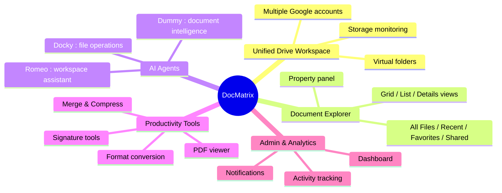
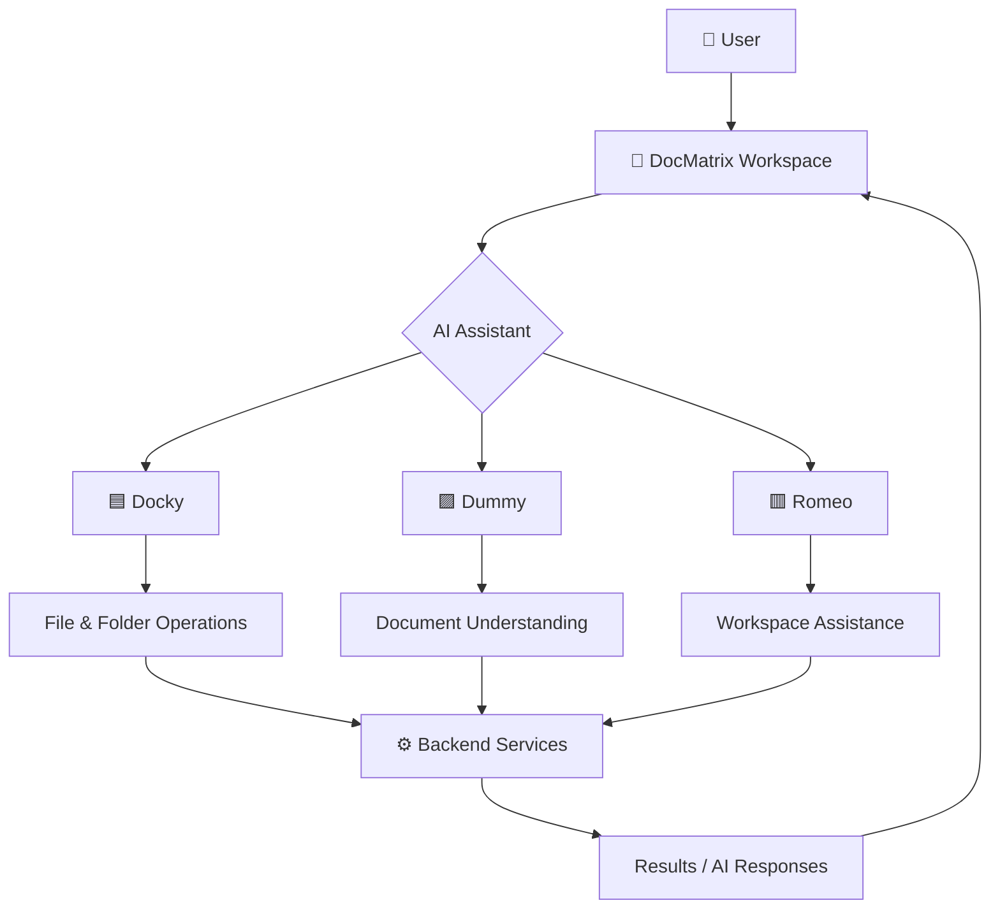
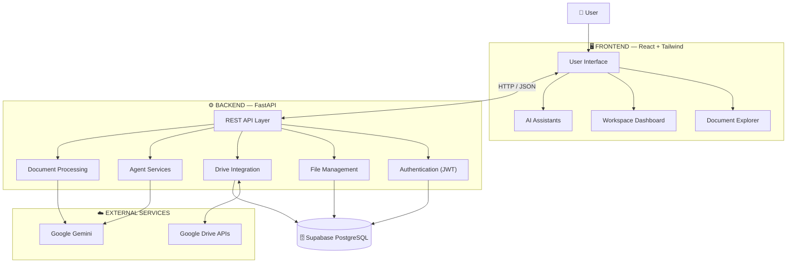
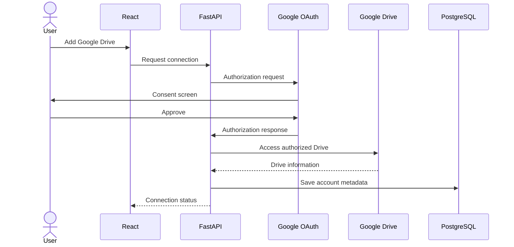
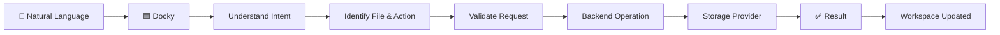
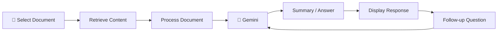
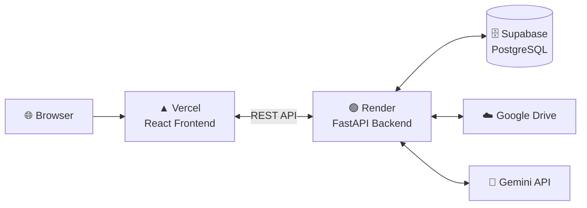

<div align="center">
 📂 **D O C M A T R I X **
 
### Intelligent Document Management & Agentic Workspace
 
**Multiple Google Drives. One Workspace. Three AI Agents.**
 
[](https://python.org)
[](https://fastapi.tiangolo.com)
[](https://react.dev)
[](https://tailwindcss.com)
[](https://www.postgresql.org)
[](https://supabase.com)
[](https://ai.google.dev)
[](https://vercel.com)
[](https://render.com)
 
<p align="center">
  <a href="https://docmatrixsdms.vercel.app"><b>🌐 Live App</b></a> •
  <a href="https://docmatrix.onrender.com"><b>⚙️ Backend API</b></a> •
  <a href="https://github.com/premnarayn13"><b>👨‍💻 GitHub</b></a>
</p>
<p align="center">
  <a href="#-the-problem--the-solution">Problem</a> •
  <a href="#-feature-map">Features</a> •
  <a href="#-ai-agent-fleet">Agents</a> •
  <a href="#-system-architecture">Architecture</a> •
  <a href="#-core-workflows">Workflows</a> •
  <a href="#-tech-stack">Tech Stack</a> •
  <a href="#-security">Security</a> •
  <a href="#-deployment">Deployment</a> •
  <a href="#-local-setup">Setup</a>
</p>
---
 
</div>
## 🎯 The Problem & The Solution
 
| ❌ Without DocMatrix | ✅ With DocMatrix |
| :--- | :--- |
| Files scattered across multiple Google Drive accounts | **One unified explorer** for every connected Drive |
| Constantly switching accounts to find a file | **Single search & browse** experience |
| Manual clicking for rename, move, compress, merge | **Natural-language commands** via an AI agent |
| Reading long documents to find a detail | **Summaries, Q&A & entity extraction** powered by Gemini |
| Separate tools for PDF merge / compress / convert | **Built-in PDF & document utilities** |
| No visibility into storage across accounts | **Storage dashboard** across all Drives |
 
> **One-line pitch:** DocMatrix turns many Google Drives into a single, AI-controlled document workspace, so you can talk to your files instead of hunting for them.
 
---
 
## ⚡ At a Glance
 
| 🔗 | 🤖 | 🎙️ | 🧠 | 🛠️ |
| :---: | :---: | :---: | :---: | :---: |
| **Multi-Drive**<br>OAuth-connected accounts | **3 AI Agents**<br>Docky · Dummy · Romeo | **Voice**<br>Input & output | **Gemini**<br>Document intelligence | **PDF Tools**<br>Merge · Compress · Convert |
 
---
 
## ✨ Feature Map
 

 
### ☁️ 1. Unified Google Drive Workspace
 
| Capability | What You Get |
| :--- | :--- |
| **Multi-Account Connect** | Link any number of Google Drive accounts through Google OAuth |
| **Single Interface** | Browse every account's files without switching logins |
| **Virtual Folders** | Organize files from different Drives under one central structure |
| **Storage Monitoring** | See connected-drive info and available space per account |
 
### 📁 2. Intelligent Document Explorer
 
| Views | Sections | Panels |
| :--- | :--- | :--- |
| 🔲 Grid | 📄 All Files | 🔎 Property Panel |
| 📋 List | 🕒 Recent | ℹ️ Details / Metadata |
| 🧾 Details | ⭐ Favorites | |
| | 🤝 Shared | |
 
**File operations:** create · rename · move · copy · upload · download · compress · merge · convert · generate share links · tag · favorite
 
### 🧠 3. AI Document Intelligence
 
Select any document and let **Dummy** work on it:
 
| Action | Output |
| :--- | :--- |
| 📝 Summarize | Structured document summary |
| ❓ Ask questions | Answers grounded in the selected document |
| 🏷️ Extract entities | Names, dates, locations & key information |
| 💬 Follow-ups | Conversation continues with the same document context |
 
### ⚡ 4. Agentic Automation
 
Say it. Docky does it.
 
| You say | DocMatrix does |
| :--- | :--- |
| *"Rename this file to Report 2026"* | ✏️ Renames the document |
| *"Create a folder named Projects"* | 📁 Creates the folder |
| *"Move these files to Projects"* | 📦 Moves the selected files |
| *"Compress these documents"* | 🗜️ Compresses them |
| *"Find my recent PDF files"* | 🔍 Searches and lists matches |
| *"Generate a sharing link"* | 🔗 Creates a shareable link |
 
**Also supported:** multi-action execution · voice input · voice output · interactive voice conversations · ⚡ Performance Mode · 🛡️ Safe Mode
 
### 🛠️ 5. Productivity Tools
 
`PDF Viewer` · `Merge` · `Compress` · `Format Conversion` · `Digital Signature Tools` · `Document Analysis & Extraction` · `Backup Utilities`
 
### 📊 6. Workspace & Administration
 
`Dashboard` · `Storage Utilization` · `Connected-Drive Monitoring` · `Activity Tracking` · `Workspace Settings` · `Admin Analytics` · `Notifications & Operation Feedback`
 
---
 
## 🤖 AI Agent Fleet
 
Three specialized agents, each with a clear role:
 
<table>
<tr>
<td width="33%" valign="top">
### 🟦 DOCKY
**Document Management Agent**
 
Turns instructions into file operations.
 
- Natural-language file & folder control
- Multi-file operations
- Search · rename · move · copy
- Compress · merge · convert
- Share links · tags · favorites
- Voice interaction
- Performance & Safe modes
`Instruction → Intent → Action → Tool → Result`
 
</td>
<td width="33%" valign="top">
### 🟪 DUMMY
**Document Intelligence Assistant**
 
Understands what's *inside* your documents.
 
- Summarization
- Contextual Q&A
- Entity extraction
- Date · name · location detection
- Document-specific follow-ups
`Select → Process → Gemini → Response`
 
</td>
<td width="33%" valign="top">
### 🟥 ROMEO
**AI Workspace Assistant**
 
Workspace-level assistance alongside Docky and Dummy.
 
- Extends the AI workspace experience
- Operates as a specialized assistant in the same agent ecosystem
`Request → Workspace Context → Response`
 
</td>
</tr>
</table>
### Agent Interaction Model
 

 
---
 
## 🏛️ System Architecture
 

 
### Layer Responsibilities
 
| Layer | Responsibility |
| :--- | :--- |
| 🖥️ **React Frontend** | Workspace, explorer, and AI interfaces |
| 🚪 **REST API Layer** | Request handling, routing, validation |
| 🔐 **Authentication** | Verifies users, protects resources |
| ☁️ **Drive Integration** | Connects and manages authorized Google Drives |
| 🤖 **Agent Services** | Interprets instructions, invokes backend tools |
| 📄 **Document Processing** | Content extraction and preparation |
| 🧠 **Gemini Integration** | Document understanding and Q&A |
| 🗄️ **PostgreSQL (Supabase)** | Persistent application data and metadata |
 
> 💡 **Design note:** Documents stay in their original Google Drive accounts. The database stores application records and metadata, not duplicate copies of every file.
 
---
 
## 🔄 Core Workflows
 
### 1️⃣ Connecting a Google Drive
 

 
### 2️⃣ Agentic File Operation (Docky)
 

 
### 3️⃣ Document Question Answering (Dummy)
 

 
---
 
## ⚙️ Tech Stack
 
| Layer | Technology | Purpose |
| :--- | :--- | :--- |
| **Frontend** |    | Interactive workspace, logic, responsive styling |
| **Backend** |   | Async APIs, validation, integrations |
| **Database** |   | Relational storage on managed infrastructure |
| **AI** |  | Document understanding & Q&A |
| **Integrations** |   | External storage & authorized access |
| **Auth** |  | Token-based API protection |
| **Hosting** |   | Frontend and backend deployment |
 
---
 
## 🔐 Security
 
| Mechanism | Purpose |
| :--- | :--- |
| 🎫 **JWT Authentication** | Protects application API endpoints |
| 🔑 **Google OAuth 2.0** | User-approved access to each Drive account |
| ✅ **Backend Validation** | Every file operation is validated before execution |
| 🙈 **Environment Variables** | API keys and secrets stay out of source code |
| 👤 **User Access Controls** | Keeps resources scoped to each user |
| 🛡️ **Safe Mode (Docky)** | Restricted execution for safer agent actions |
 
> **Principle:** Google controls Drive permissions. DocMatrix handles application-level authentication and operation validation. The two are kept separate.
 
---
 
## 🚀 Deployment
 

 
| Service | Platform | Link |
| :--- | :--- | :--- |
| 🖥️ Frontend | Vercel | [docmatrixsdms.vercel.app](https://docmatrixsdms.vercel.app) |
| ⚙️ Backend | Render | [docmatrix.onrender.com](https://docmatrix.onrender.com) |
| 🗄️ Database | Supabase | PostgreSQL (managed) |
 
> ⏳ The backend runs on Render, so the first request after inactivity may take a few seconds to wake up.
 
---
 
## 💻 Local Setup
 
### 📋 Prerequisites
 
- Python **3.11+**
- Node.js & npm
- Git
- Supabase account
- Google Cloud project with **Drive API** enabled
- Google **OAuth credentials**
- **Gemini API** key
### 1️⃣ Clone
 
```bash
git clone https://github.com/premnarayn13/DocMatrix.git
cd DocMatrix
```
 
### 2️⃣ Backend
 
```bash
python -m venv venv
 
# Windows
venv\Scripts\activate
 
# Linux / macOS
source venv/bin/activate
 
pip install -r requirements.txt
```
 
### 3️⃣ Environment Variables
 
Create a `.env` file in the backend:
 
```env
GEMINI_API_KEY=your_gemini_api_key
 
SUPABASE_URL=your_supabase_url
SUPABASE_KEY=your_supabase_key
 
GOOGLE_CLIENT_ID=your_google_client_id
GOOGLE_CLIENT_SECRET=your_google_client_secret
```
 
### 4️⃣ Run Backend
 
```bash
python run.py
```
 
Or run FastAPI directly:
 
```bash
uvicorn app.main_new:app --reload --port 8000
```
 
### 5️⃣ Run Frontend
 
```bash
npm install
npm run dev
```
 
Open the local URL shown by Vite.
 
---
 
 
## 👨‍💻 Author
 
**Prem Narayn N L**
B.Tech — Artificial Intelligence & Data Science
 
[](https://github.com/premnarayn13)
 
---
 
<div align="center">
### DOCMATRIX
 
**One Workspace. Multiple Drives. Intelligent Document Management.**
 
<sub>Built to simplify how documents are stored, organized, understood, and managed.</sub>
 
</div>
 
